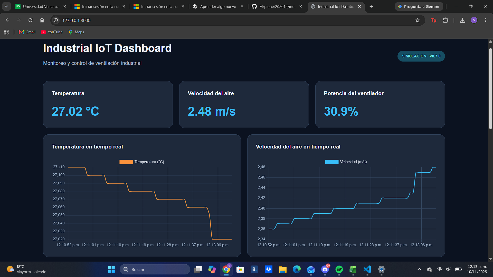
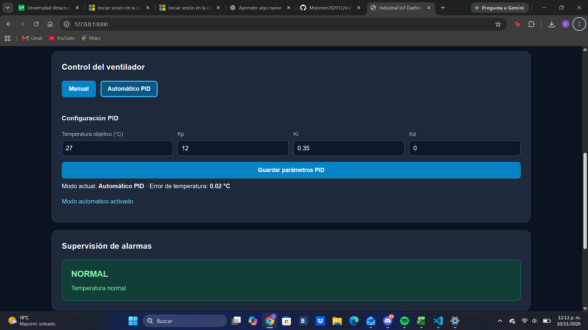
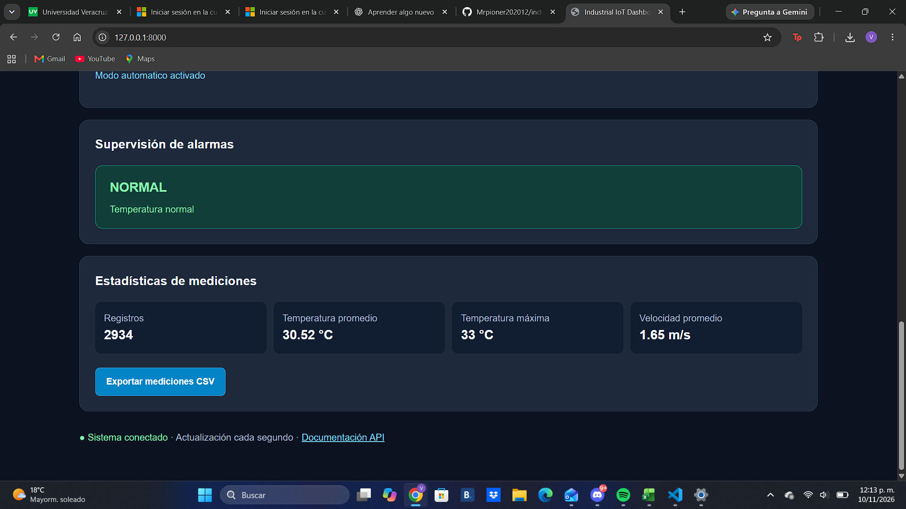

# Industrial IoT Monitoring Platform

### Real-Time Industrial Monitoring and PID Control with Python

An industrial monitoring and control platform developed with Python, FastAPI, MQTT, SQLite, and a web-based dashboard.

The project simulates an industrial ventilation process, providing real-time temperature monitoring, airflow measurement, automatic PID control, alarm detection, historical data storage, and visualization.

It demonstrates practical concepts in industrial instrumentation, automation, software engineering, and Industrial Internet of Things (IIoT).

## Project Overview

Industrial monitoring systems help operators supervise processes, analyze measurements, and adjust control parameters.

This project implements a simulated industrial ventilation system with the following capabilities:

- Real-time temperature monitoring
- Simulated airflow velocity measurement
- Fan power monitoring and control
- Automatic PID temperature control
- Manual fan control
- MQTT communication
- Alarm detection
- Historical data storage
- Measurement statistics
- CSV data export
- Web-based monitoring dashboard
- Automated software tests

The platform is designed as an educational and portfolio project. It uses simulated process measurements rather than physical industrial sensors.

## Technologies

| Technology | Purpose |
|------------|---------|
| Python | Main programming language |
| FastAPI | Backend and REST API |
| Uvicorn | ASGI application server |
| MQTT | Messaging and communication |
| Eclipse Mosquitto | Local MQTT broker |
| Paho MQTT | Python MQTT client |
| SQLite | Historical data storage |
| HTML | Dashboard structure |
| CSS | Dashboard styling |
| JavaScript | Frontend functionality |
| Pytest | Automated testing |
| Git and GitHub | Version control |

## System Architecture

The platform is organized into several software components:

1. Industrial process simulator
2. PID controller
3. MQTT communication services
4. FastAPI backend
5. SQLite database
6. Web dashboard
7. Alarm monitoring system

### General Data Flow

```text
Industrial Process Simulator
            |
            v
   Simulated Measurements
            |
            v
      FastAPI Backend
       /     |      \
      v      v       v
    MQTT   SQLite   Alarms
      \      |       /
       \     |      /
        v    v     v
        Web Dashboard
              |
              v
      Control Commands
              |
              v
        PID Controller
              |
              v
       Fan Power Control
```

The backend coordinates process simulation, monitoring, control, and data storage.

## Main Features

### 1. Real-Time Monitoring

The dashboard displays process variables such as:

- Temperature (°C)
- Airflow velocity (m/s)
- Fan power (%)
- Temperature setpoint (°C)
- Control error (°C)

Measurements are visualized through interactive dashboard elements and monitoring charts.

### 2. PID Temperature Control

The platform includes an automatic PID controller.

The controller calculates a control output based on the difference between the desired temperature and the measured process temperature.

The control error is:

```text
error = setpoint - measured_temperature
```

The general PID control equation is:

```text
u(t) = Kp * e(t)
     + Ki * integral(e(t) dt)
     + Kd * de(t)/dt
```

Where:

- Kp: Proportional gain
- Ki: Integral gain
- Kd: Derivative gain
- e(t): Control error
- u(t): Controller output

The dashboard allows users to configure PID parameters and operate the system in manual or automatic mode.

### 3. MQTT Communication

MQTT is used as a lightweight messaging protocol for communication between software components.

The project uses a local Mosquitto MQTT broker and Python MQTT clients.

This demonstrates concepts commonly used in IoT and industrial monitoring applications.

### 4. Alarm Monitoring

The application includes an alarm monitoring component to detect abnormal simulated process conditions.

Alarm information is displayed through the web interface to support process supervision.

### 5. Historical Data and Statistics

Process measurements are stored in a local SQLite database.

The dashboard provides access to measurement history and statistics.

### 6. CSV Export

Users can export measurement data in CSV format for additional analysis using Python, Excel, or other tools.

## Project Screenshots

### Real-Time Industrial Monitoring

The dashboard displays temperature, airflow velocity, fan power, and real-time monitoring charts.



### Automatic PID Control

The platform provides manual and automatic control modes, configurable PID parameters, and temperature setpoint tracking.



### Alarm Monitoring and Statistics

The system includes alarm monitoring, historical measurements, statistics, and CSV export functionality.



## Project Structure

```text
industrial-iot-monitoring-platform/
|
|-- main.py
|-- simulator.py
|-- pid_controller.py
|-- alarms.py
|-- database.py
|-- mqtt_service.py
|-- mqtt_monitor.py
|-- requirements.txt
|-- test_pid_simulation.py
|-- README.md
|
|-- tests/
|   |-- test_api.py
|
|-- templates/
|   |-- index.html
|
|-- static/
|   |-- dashboard.js
|   |-- style.css
|
|-- docs/
|   |-- screenshots/
|       |-- dashboard.png
|       |-- pid-control.png
|       |-- alarms-statistics.png
|
|-- .gitignore
```

## Installation

### Requirements

- Python 3
- pip
- Git
- Mosquitto MQTT broker (for MQTT functionality)

### 1. Clone the Repository

```bash
git clone https://github.com/Mrpioner202012/industrial-iot-monitoring-platform.git
```

### 2. Enter the Project Directory

```bash
cd industrial-iot-monitoring-platform
```

### 3. Create a Virtual Environment

On Windows:

```powershell
py -m venv .venv
```

Activate it:

```powershell
.\.venv\Scripts\Activate.ps1
```

### 4. Install Dependencies

```bash
python -m pip install -r requirements.txt
```

### 5. Start the MQTT Broker

For MQTT functionality, start a local Mosquitto broker on the default port:

```text
localhost:1883
```

The MQTT broker must be installed and configured separately.

### 6. Run the Application

```bash
python -m uvicorn main:app --reload
```

Alternatively, on Windows:

```powershell
py -m uvicorn main:app --reload
```

### 7. Open the Dashboard

Visit:

http://127.0.0.1:8000

### 8. Explore the API

FastAPI provides interactive API documentation at:

http://127.0.0.1:8000/docs

## Testing

The project includes automated tests for API functionality and control simulation.

Run the test suite with:

```bash
python -m pytest -q
```

Individual tests can also be executed during development.

## Engineering Applications

This project demonstrates software and engineering concepts relevant to:

- Industrial instrumentation
- Industrial automation
- Process monitoring
- PID control systems
- Industrial IoT
- Backend development
- Data acquisition concepts
- Software testing
- Industrial data visualization

## Current Limitations

This is a simulated industrial monitoring platform.

The current implementation does not provide direct control of physical industrial equipment.

Future integration with sensors, microcontrollers, PLCs, or industrial communication gateways would require additional hardware, software validation, and appropriate safety measures.

## Future Improvements

Potential improvements include:

- Integration with physical temperature and airflow sensors
- PLC communication
- Modbus TCP integration
- Remote deployment
- User authentication
- Additional alarm configurations
- Advanced historical analytics
- Docker containerization
- Automated deployment pipelines

## Project Purpose

This project was developed to strengthen practical skills in Python programming, industrial automation, instrumentation, process control, and IoT software development.

It also serves as a technical portfolio project demonstrating the integration of backend services, industrial process simulation, control algorithms, communication protocols, and data visualization.

## Author

**Jesús Eduardo Vega Córdova**

Electronic Instrumentation Engineering Student

GitHub: [Mrpioner202012](https://github.com/Mrpioner202012)

## Disclaimer

This project is intended for educational, simulation, and software demonstration purposes.

It is not certified for safety-critical industrial control applications.
